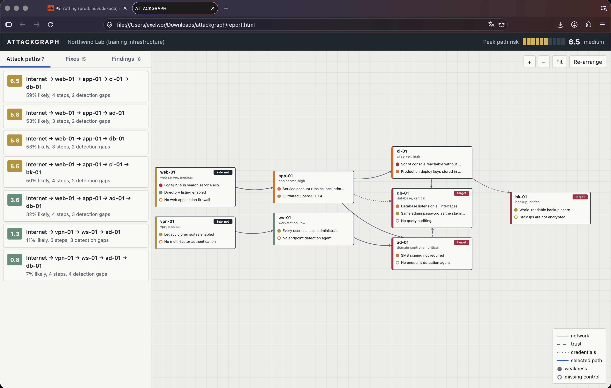

# ATTACKGRAPH

> **Status:** v0.1, early release. The risk score is an explainable model, not a measurement.
> Use it only on environments you own or are authorized to assess.



ATTACKGRAPH takes the results of a security audit of a **lab or test environment you own**, chains the
individual weaknesses into **attack paths**, scores them, explains them in plain language and tells you
**which single fix removes the most risk**.

It is a defensive analysis tool: it reads audit data, it never scans, probes or exploits anything.

```
audit.json ──> import ──> normalize ──> graph ──> risk analysis ──> report / web UI / API
```

## Quick start

```bash
pip install -e ".[dev]"

attackgraph sample > audit.json                 # a ready-made example lab
attackgraph analyze audit.json -o report.html   # interactive, self-contained report
open report.html                                # or double-click it
```

Web app (upload files, history, shareable links):

```bash
attackgraph serve            # http://127.0.0.1:8000
# or
docker compose up --build
```

> **Warning:** the web server has no authentication. By default it listens on `127.0.0.1` only.
> Never expose it to the internet; if you must share it, put it behind a reverse proxy with a login.

## What you get

* **Attack paths** from every internet-facing asset to every critical asset, ranked by risk, with a
  step-by-step explanation of each hop.
* **A fix list** computed by actually re-running the analysis without each finding: how many paths it cuts
  and how much total exposure it removes. Preview any fix on the graph.
* **Detection gaps**: missing controls (no EDR, no MFA, no logging) do not open doors, but they make the
  paths along them more dangerous, and the report says so.
* **Input validation that helps**: every problem in a file is reported at once with its location
  (`findings[3].severity: unknown value 'banana' ...`).
* **A CI gate**: `attackgraph analyze audit.json --fail-on 7` exits with code 1 if any path scores 7 or more.

## Input format

```json
{
  "name": "My lab",
  "assets": [
    {"id": "web-01", "name": "web-01", "type": "web_server", "criticality": "medium", "exposure": "internet"},
    {"id": "db-01", "type": "database", "criticality": "critical"}
  ],
  "findings": [
    {"id": "F-01", "asset": "web-01", "kind": "vulnerability", "severity": "critical",
     "title": "Outdated component allows remote code execution", "cve": "CVE-2021-44228",
     "tags": ["unpatched"], "remediation": "Upgrade to 2.17.1 or later."}
  ],
  "relations": [
    {"source": "web-01", "target": "db-01", "kind": "credentials",
     "description": "database password is in the app config"}
  ]
}
```

| Field | Values |
|-------|--------|
| asset `criticality` | `low`, `medium` (default), `high`, `critical` |
| asset `exposure` | `internal` (default), `internet` (marks an entry point) |
| finding `kind` | `vulnerability`, `misconfiguration`, `permission`, `missing_control` |
| finding `severity` | `low`, `medium`, `high`, `critical`, or a CVSS number (0-10) |
| relation `kind` | `network` (default), `trust`, `credentials`; add `"bidirectional": true` for both ways |

Common synonyms are accepted (`vuln`, `moderate`, `public`, `iam`, ...). Ids must be unique across assets
and findings. Run `attackgraph validate audit.json` to check a file.

## How the score works

Small enough to verify by hand (see `src/attackgraph/risk.py`):

| Quantity | Definition |
|----------|------------|
| Weakness probability | low 0.2, medium 0.4, high 0.7, critical 0.9 |
| Step probability | `1 - product(1 - p)` over the weaknesses of the asset being entered (max 0.95); a fixed 0.6 / 0.7 for `trust` / `credentials` relations |
| Path likelihood | product of its step probabilities |
| Path impact | criticality of the last asset: 2.5 / 5 / 7.5 / 10 |
| Path risk | `min(10, likelihood x impact x (1 + 0.05 per missing control, at most 4))` |
| Headline score | the highest path risk |
| Exposure index | the sum of all path risks (used to rank fixes) |

Targets are the assets with the highest criticality in the file, provided it is at least `high`.
Paths are limited to 6 assets.

These numbers are a model, not a measurement. They are useful for comparing fixes inside one environment,
not for comparing different organizations.

## Architecture

| Module | Role |
|--------|------|
| `importer.py` | read JSON from files, bytes or dicts |
| `normalization.py` | map vocabulary, validate, build immutable models |
| `models.py` | `Asset`, `Finding`, `Relation`, `AuditData` |
| `graph.py` | NetworkX property graph and attack-surface graph |
| `risk.py` | path search, scoring, what-if fix ranking |
| `pipeline.py` | one JSON result consumed by every front end |
| `report.py` | Markdown and standalone HTML reports |
| `web/viewer.html` | the interactive UI (plain JS and SVG, no build step, works offline) |
| `api.py`, `storage.py` | FastAPI app and SQLite history |

API: `POST /api/analyze` (optional `?fix=F-01&fix=F-02`), `GET /api/analyses`, `GET /api/analyses/{id}`,
`GET /api/analyses/{id}/report.html`, `GET /api/analyses/{id}/report.md`, `DELETE /api/analyses/{id}`,
`GET /api/sample`, `GET /api/health`. Interactive docs at `/docs`.

## Development

```bash
pip install -e ".[dev]"
pytest -q
ruff check .
```

## Roadmap

* Adapters for real scanner formats (Nessus, OpenVAS, Trivy, Prowler), which map into the same input.
* PostgreSQL storage behind the existing `Storage` interface.
* Rust implementation of the path search for large graphs.
* React front end if the UI outgrows a single file.

## License

MIT. See [LICENSE](LICENSE).
